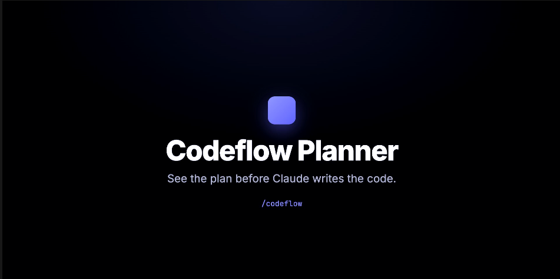

# Codeflow Planner

[](docs/media/launch.mp4)

Plan code changes with Claude on a visual canvas. Run `/codeflow` in any repo: Claude opens the
repo's plan (`<repo>/.codeflow/`) in a browser canvas that belongs to that session, keeps it in
sync with the code, and works through it with you. The canvas closes when the session ends, so
several repos can each have their own canvas at the same time.

The canvas is laid out like VS Code: an activity bar, a side bar, editor tabs and a status bar.
It has four views:

- **Flows**: one tab per repo folder, each holding code flows (sequence of steps, drill-down panels).
- **Classes**: a UML class diagram in Clean Architecture swimlanes, with dependency-rule errors and
  SOLID warnings (SRP, OCP, LSP, ISP, DIP).
- **Messages**: comment threads between you and Claude on any node, class or task.
- **Execution** (hidden until you ask for it): the orchestrator's split of the work into
  sub-agents. Drag tasks between agents; Claude follows your assignment when it executes.

## Getting around

| Do | How |
|---|---|
| Jump to any folder, flow, class, task, view or action | Ctrl+K (or the search button in the status bar) |
| List the methods (flows) in the open folder and pan to one | M (or **ƒ Methods** in the canvas toolbar) |
| Switch views | Ctrl+1 Flows · Ctrl+2 Classes · Ctrl+3 Messages · Ctrl+4 Execution (when shown) |
| Hide / show the side bar | Ctrl+B, or click the active view's icon |
| Resize the side bar or inspector | drag its edge; double-click the edge to reset |
| Reorder editor tabs | drag a tab; middle-click closes it |
| Arrange the class diagram | drag classes (saved in `diagram.json`); **Tidy layout** resets |
| Read a UML arrow | hover it: "A composes B · via self.repo" |
| Split work between sub-agents | drag task cards between columns or onto a card; drag a column header to reorder agents |

Hover anything (icons, tree rows, findings, task cards, status bar) for a description and
its shortcut. Animations follow the system's reduced-motion setting.

## Install (Claude Code)

```
npm install
npm run build                                   # assembles the plugin in plugin/
claude plugin marketplace add /abs/path/to/codeflow-planner
claude plugin install codeflow@codeflow-local
```

Then in any repo: `/codeflow` (optionally followed by what you want to plan). For Cursor, Codex
and other MCP clients see [docs/agents.md](docs/agents.md). After changing this repo, run
`npm run build` again and `/plugin` → update (or reinstall) to pick up the new build.

## What `/codeflow` does

The core protocol is [instructions/codeflow.md](instructions/codeflow.md); the rules for each
kind of work (planning, layers, execution, validation…) are separate guides in
[instructions/topics](instructions/topics), loaded with `codeflow_guide` only when needed. In short:

1. `codeflow_open` binds `<repo>/.codeflow` and starts the canvas on a free port.
   - **Existing plan**: `codeflow_sync` refreshes flows from the code. New entry points get flows;
     generated flows whose code changed are updated, keeping status and notes; flows you edited
     by hand are never overwritten (a `check` note flags the conflict instead).
   - **Code but no plan**: a plan is created with one tab per Python source folder and
     `codeflow_sync` draws the code as it is. Claude then asks whether to validate the flows
     with sub-agents, which model they run on (Haiku, Sonnet, Opus, or skip) and whether to
     also reword them into plain language. The question shows the size of the job; trivial
     flows are skipped and there is one sub-agent per ~30 flows (at most 6).
   - **Empty repo**: a Clean Architecture plan is created by default (`app/domain`,
     `app/application/use_cases|ports`, `app/adapters/...`, `app/infrastructure`). Nothing is
     created on disk until you approve and Claude runs `codeflow_project({ scaffold: true })`.
2. Working loop: Claude drafts flows (`proposed`) → you comment on the canvas → "check the
   canvas" → Claude replies and edits → you approve → Claude implements and updates statuses.
3. `codeflow_classes` re-checks the architecture before and after implementing.
4. "Plan the execution" makes Claude propose sub-agents and tasks; "execute the plan" runs them
   wave by wave, exactly as assigned on the canvas. Agents without a model are not started
   until you choose one.

## MCP tools

| Tool | Purpose |
|---|---|
| `codeflow_open` | open or create `<root>/.codeflow`, start this session's canvas |
| `codeflow_guide` | one part of the protocol (`planning`, `format`, `layers`, `new-project`, `execution`, `validation`) |
| `codeflow_read` | overview (flow counts + the completeness check), or one folder tab / flow as `json`, a compact `outline`, or a `list` of flows |
| `codeflow_validate` | size of a flow validation and the questions to ask; with the user's `model` and `rewrite`, one prompt per sub-agent |
| `codeflow_project` | set name, folders, layer mapping; `scaffold` creates the planned folders (new projects, after approval) |
| `codeflow_sync` | refresh flows from the code; `entries` / `replace` generate specific entry points in one folder |
| `codeflow_classes` | UML class model + dependency-rule and SOLID findings |
| `codeflow_execution` | read / write / set_status / set_model / reveal / hide the execution plan |
| `codeflow_edit` | write a whole flow (`flow`) or apply targeted `edits` |
| `codeflow_messages` | list canvas threads, or reply / start / resolve one (`op: 'reply'`) |

`codeflow_sync` and `codeflow_edit` return `check`: new flows nothing calls, calls without links, broken links, wrong change types.
Long lists in tool results are cut to the first 8 with a count of the rest, so results stay small on large plans.

## Plan files (`<repo>/.codeflow/`)

| File | Contents |
|---|---|
| `project.json` | `{ name, folders, layers?, scaffold?, solid? }`; `root` only for plans kept outside their repo |
| `tabs/<folder>.json` | `{ folder, flows, positions? }` (`/` in the folder name becomes `__`) |
| `classes.json` | last class model and findings (regenerated, safe to delete) |
| `execution.json` | `{ visible, orchestrator, agents, tasks }` |
| `diagram.json` | class positions you set by dragging in the Classes view |
| `threads.json` | message threads |
| `.session.json` | URL and pid of the live canvas (gitignored) |

`solid` in `project.json` overrides the SOLID thresholds, e.g.
`{ "maxPublicMethods": 12, "maxCollaborators": 8 }`
(see `src/domain/classes/solidRules.js` for the full list).

## Generating flows from code

`src/infrastructure/extract_py.py` only parses the source with `ast` (stdlib, run with `python3 -I`); the
target code is never imported or executed. It maps:

| Code | Canvas |
|---|---|
| awaited call, or call into this repo | step card (inputs from parameters, returns from targets) |
| same-folder helper | detail panel with its pseudo-code |
| call into another folder | `↗ folder` link |
| `asyncio.gather` / `asyncio.wait(..., FIRST_COMPLETED)` + `create_task` | gather / race card |
| `try` / `for` / `while` around calls | try / loop frame on the spine |
| runs of plain statements | "validate input" / "respond" / "compute …" card |
| pydantic-style classes in the signature | reference tables |

Python 3.9 can't parse `match`, so on older interpreters match/case is rewritten into
equivalent `if` conditions; files that still fail are listed as warnings. Use a newer Python
with `CODEFLOW_PYTHON=/path/to/python3 npm run dev`.

## Notation

Vertical = sequence (spine of step cards). Horizontal = drill-down to detail panels.

| Element | Meaning |
|---|---|
| Step card | module · step · function, inputs table, `returns` bar |
| Gather card (`⑂ race / gather / any`) | parallel tasks + join mode |
| Detail panel | top-down pseudo-code: `<>` conditions, loops (↻ + back-edge), try/except |
| Purple / orange node | internal service call / external system call |
| Green node / green outline | raise or exit / return |
| `await` pill | awaited call |
| Dashed edge | fire & forget |
| `↗ folder` chip | jumps to the tab where that call lives |

### Conventions

- Keep one step per function call or processing stage. Put the detail inside side panels.
- Panels on the left and right of a step are alternative views of the same step, not a sequence.
  If one thing must run before another, make them separate steps.
- Use `notes` (`question`, `check`, `idea`, `fix`) for open points. Remove them once resolved.

Each tab file: `{ folder, flows: [{ id, title, entry, spine, refs, notes }], positions? }`.
`positions` holds manual drag offsets (`Tidy layout` clears them).


## Development

```
npm run dev            # canvas with hot reload on http://localhost:5199
                       # (demo plan in test/fixtures/solid_py; CODEFLOW_PLAN_DIR=/path/to/repo/.codeflow npm run dev)
npm test               # domain + extractor tests
npm run check:arch     # this repo's own Clean Architecture dependency rule
npm run build          # plugin/ (canvas, bundled MCP server, /codeflow skill)
```

This repo follows Clean Architecture:

| Layer | Folder | Contains |
|---|---|---|
| domain | `src/domain` | plan model, edits, sync merge, layer rules, SOLID rules, execution model (pure) |
| application | `src/application` | ports and use cases |
| adapters | `src/adapters` | MCP tools, HTTP routes + SSE, React UI |
| infrastructure | `src/infrastructure` | file-backed repository, Python extractor, workspace, browser opener |
| main | `src/main` | composition roots: MCP server, UI server, Vite dev plugin |

## Editing

Click any node to open the inspector. Ctrl+Z / Ctrl+Shift+Z undo and redo, Delete removes the selection,
Esc deselects. Edits save automatically; files changed on disk (e.g. by Claude) reload live.
